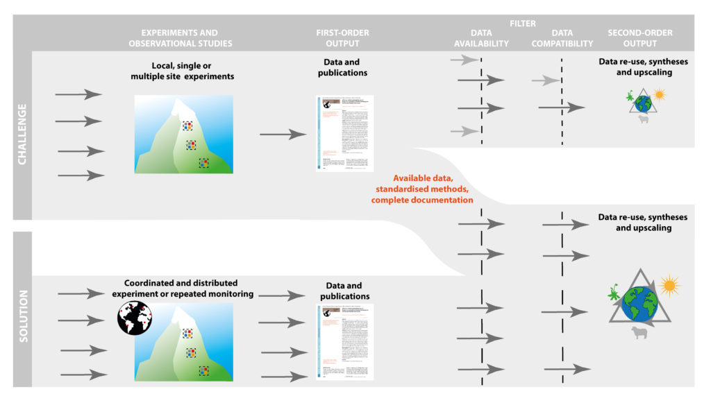

```{r, echo=FALSE}
knitr::opts_chunk$set(echo = FALSE)
```

# The Aim of ClimEx Handbook {-}

Climate change is a worldwide threat to biodiversity and ecosystem structure, functioning, and services. To understand the underlying drivers and mechanisms, and to predict the consequences for nature and people, we urgently need better understanding of the direction and magnitude of climate-change impacts across the soil–plant–atmosphere continuum.

An increasing number of climate-change studies is creating new opportunities for meaningful and high-quality generalisations and improved process understanding. However, significant challenges exist related to data availability and/or compatibility across studies, compromising opportunities for data re-use, synthesis, and upscaling. Many of these challenges relate to a lack of an established “best practice” for measuring key impacts and responses. This restrains our current understanding of complex processes and mechanisms in terrestrial ecosystems related to climate change.

```{r, out.width='100%'}

```

To overcome these challenges, we collected best-practice methods emerging from major ecological research networks and experiments, as synthesised by 115 experts from across a wide range of scientific disciplines. Our handbook contains guidance on the selection of response variables for different purposes, protocols for standardised measurements of 66 such response variables, and advice on data management. Specifically, we recommend a minimum subset of variables that should be collected in all climate-change studies to allow data re-use and synthesis, and give guidance on additional variables critical for different types of synthesis and upscaling.

The goal of this community effort is to facilitate awareness of the importance and broader application of standardised methods to promote data re-use, availability, compatibility, and transparency. We envision improved research practices that will increase returns on investments in individual research projects, facilitate second-order research outputs, and create opportunities for collaboration across scientific communities. Ultimately, this should significantly improve the quality and impact of the science, which is required to fulfil society’s needs in a changing world.

[Download article as PDF](https://bioceed.uib.no/dropfolder/Climex/Halbritter_et_al-2019-Methods_in_Ecology_and_Evolution.pdf)
